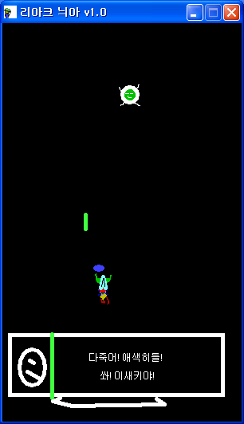

# Riakeunia

A vertical scrolling shooter. The story is told through dialogue boxes with portraits, and there are boss fights with health bars across two stages.

  

## How to play

Download from Releases and run it.

Move with the arrow keys and fire missiles with space. Ctrl is the special attack. A opens the save prompt and D the load prompt.

Press F, D and Z in order during play to get a shield. It follows the character, blocks enemy missiles and fires missiles on its own, and disappears when it runs into an enemy body.

## How it works

The cheat command works by swapping objects. Instead of remembering the input sequence in a variable, the object that listens for F changes itself into the object that listens for D when F is pressed, and that one changes into the object that listens for Z. When Z is pressed it creates the shield object and disappears. The object type is the state, so one Change Object action per step is all it takes.

Saving and loading use GameMaker's Save Game and Load Game actions as they are. A prompt comes first, and choosing yes writes the whole state to a `savegame` file.

## Files

| Path | Contents |
|---|---|
| `source/riakeunia.gmk` | Original project file |
| `source/split/` | Text tree produced by GmkSplitter |
| `docs/screenshots/` | Screenshots |
| Releases | Distributed build |

## License

CC BY-NC-ND 4.0. Unmodified copies may be shared for noncommercial purposes with attribution. Modified versions and commercial use are not allowed. Bundled libraries, graphics, sounds, and maps made by other people keep their own rights. See [LICENSE](LICENSE).
